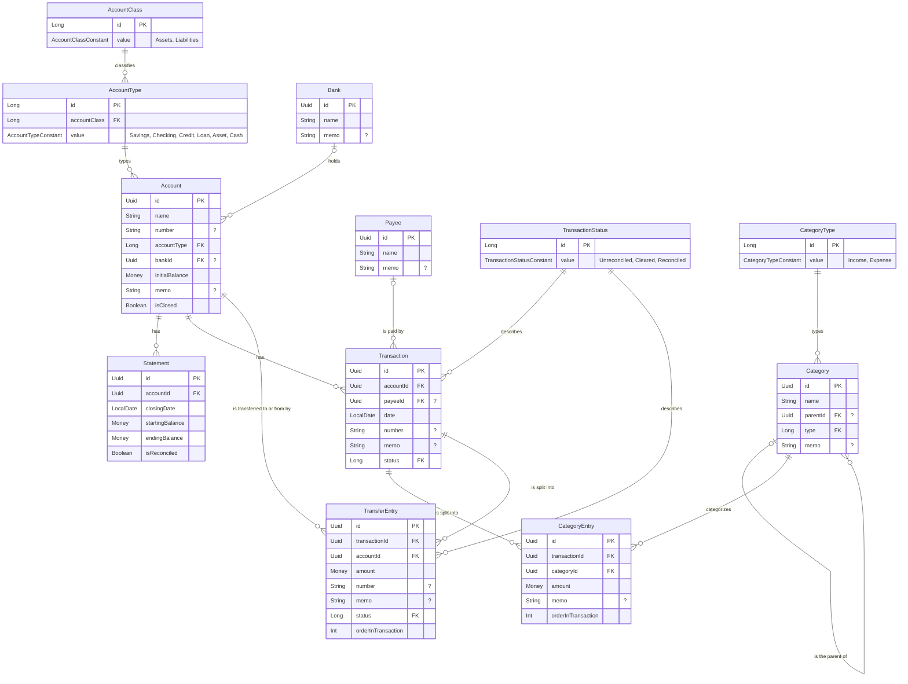

# data-api

The repository interfaces and data models for Money, implemented by [/data-sql](../data-sql/src).

### Entity relationships

Attributes use the models' property names. Properties that hold another entity (such as `Account.accountType`)
are shown as a foreign key to it, and `?` marks a nullable property. `Money` is an amount in whole fractional units
(e.g. cents) with its currency.

A transaction's entries (`CategoryEntry` and `TransferEntry`, both `TransactionEntry`s) each change the balance of
the transaction's account by their `amount`. A `TransferEntry` also changes the balance of its own `accountId` by the
negation of its `amount`.

`RegisterEntry` isn't stored: it's a read model that `RegisterRepository` builds from these entities for an account's
register, with a running balance.
